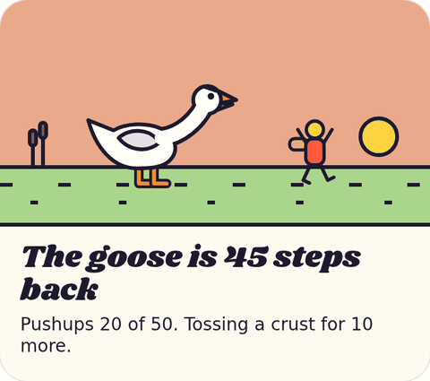
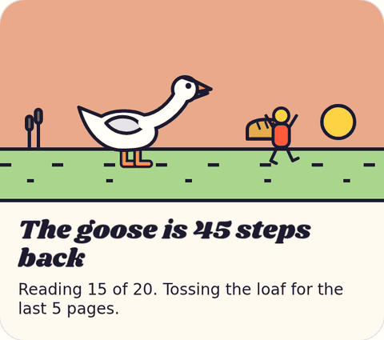
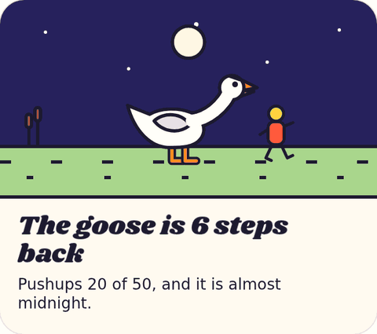

# Feed the Goose

A habit app for iOS. A goose chases you all day, and every habit you log throws it bread.

**Status:** design exploration. There is no app code yet. The clickable prototypes that
settled the design are in [`docs/prototypes`](docs/prototypes).

| A crust lands | The goose is fed | The goose catches you |
| --- | --- | --- |
|  |  |  |

## The idea

- You set a few things you have to do every day, such as 50 pushups, a 30 minute workout, or
  20 pages of reading.
- A goose chases you from dawn to midnight. Each time you log some of a habit, you toss the
  goose a crust. It stops to eat, and you gain ground. Partial logs count: 10 of 50 pushups
  is a crust.
- Finish every habit and the goose gets the whole loaf. It is fed, and the day is won.
- Finish nothing in time and the goose catches you. The day locks.
- Logging takes one tap or one phrase, without opening the app: a widget button, Siri, or a
  Shortcuts action.
- You can share a public profile that shows how your chase is going.

The app started as "Pay the Man", with habits as daily payments. The chase replaced the debt
collector, the goose replaced the dinosaur, and feeding replaced paying. Other pursuers in the
same "X the Y" shape can follow later; the goose comes first.

## How a day works

This is the "Outrun" rule that every goose prototype uses. The numbers are examples.

- The goose takes 100 steps between 6 am and midnight.
- Each habit is worth an equal share of 100 steps. With three habits, 10 of 50 pushups earns
  7 steps, at any hour.
- Your lead is 100 steps, plus what you have earned, minus what the goose has walked.
- **Fed:** every habit is done. The goose starts 100 steps back at dawn.
- **Short day:** midnight comes with some habits unfinished and some lead left. That lead is
  where the goose starts tomorrow.
- **Caught:** your lead reaches zero. The day locks.

## Decisions

Decided by Matt:

| Decision | Detail |
| --- | --- |
| Concept | A chase. You are pursued through the day and logging habits keeps you ahead. |
| Pursuer and food | A goose, fed with bread. Other pursuers can be added over time. |
| Name | Feed the Goose. |
| Platform | iOS. |
| Partial logs | Any part of a habit can be logged. |
| Logging | Must be very easy, ideally through Apple Shortcuts. |
| Sharing | A public profile, in the spirit of [Aleph](https://readaleph.com). |
| Streak | Every day the goose is fully fed, the stakes rise. |

Proposed in the prototypes and not yet confirmed:

| Proposal | Detail | Where |
| --- | --- | --- |
| Outrun rule | The step counts and the short-day carry-over above. | `02-chase-payments`, `04-app-screens` |
| Animations | Snap for a crust, Feast when the goose is fed, Peck when it catches you. | `05-animations` |
| Rising stakes | "Grows": the goose gets bigger each fed day and turns back into a gosling when it catches you. | `06-streak-stakes` |
| Short days and the streak | A short day keeps the streak where it is. Only a catch resets it. | `06-streak-stakes` |
| Profile privacy | The profile shows the chase and the history, not habit names or amounts. | `04-app-screens` |
| Stack | Native SwiftUI with App Intents. | Below |

## Platform notes

Checked against Apple's documentation and WWDC sessions in November 2026. Nothing here has
been tried on a device.

- A Siri App Shortcut phrase must contain the app name and at most one parameter, and that
  parameter must be an `AppEntity` or `AppEnum`, never a number. So "Feed the Goose pushups"
  can log a habit's usual chunk, but not an arbitrary amount.
- A Shortcuts action can take any habit and any amount.
- Home Screen widgets, and the rectangular and circular Lock Screen widgets, can hold buttons
  that run App Intents.
- A Live Activity lasts 8 hours at most, so it cannot cover a whole day's chase.

**Stack:** native SwiftUI is the recommendation, because Siri, Shortcuts and widget buttons
all run on App Intents, which are Swift. Expo's App Intents library was in alpha and still
needed Swift, and I found nothing equivalent for Tauri.

## Open questions

- Which animation set and which streak option to build.
- Whether a short day should end the streak.
- Whether the public profile is in the first version. It is the only feature that needs a
  server.
- The goose's final art. The white goose is a placeholder, and it sits close to Untitled
  Goose Game.

## What is in this repository

| Path | Contents |
| --- | --- |
| [`docs/prototypes`](docs/prototypes) | Six clickable prototypes, their source, screenshots, animation GIFs, and the scripts that capture them. |

To try a prototype, clone the repository and open any `docs/prototypes/*.html` file in a
browser. They need no server and no network.
