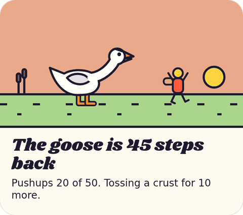
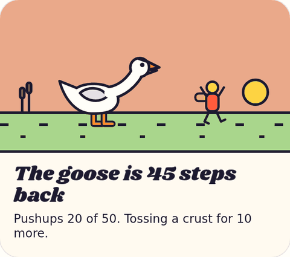
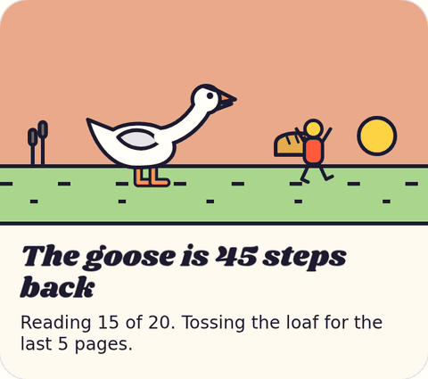
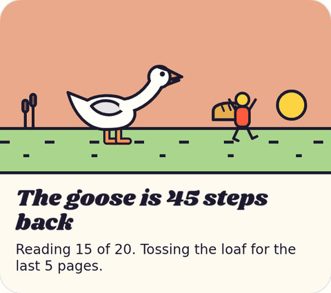
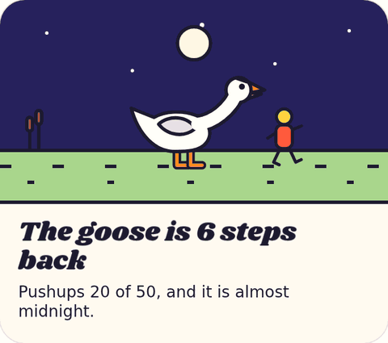
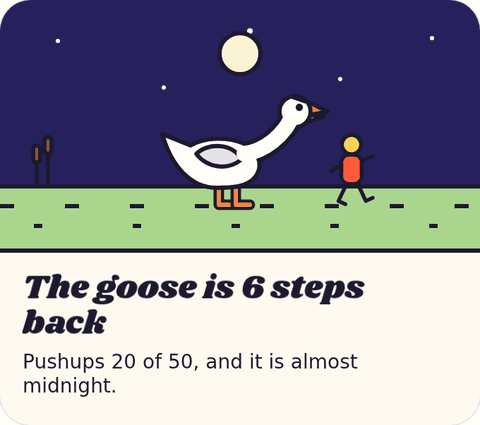

# Prototypes

Six clickable prototypes, in the order they were made on 2026-11-25. Each settled one design
question. Open any `.html` file in this folder in a browser; they need no server and no
network.

| Prototype | Question | Outcome |
| --- | --- | --- |
| [`01-directions`](01-directions.html) | What gets you to pay: a chase, The Man's attitude, or a receipt? | The chase. The Man and The Tab were dropped. |
| [`02-chase-payments`](02-chase-payments.html) | In a chase, what does a payment do? | "Outrun": each log gains a fixed number of steps. "Slow him" was rejected, because early logs gained nothing and midnight was a jump. |
| [`03-chase-metaphors`](03-chase-metaphors.html) | Do you run, pay, or fend the pursuer off, and who chases you? | Fend off, which became throwing bread. The dinosaur, pirate and ghost were set aside as later pursuers. |
| [`04-app-screens`](04-app-screens.html) | Does a goose and bread hold up across the Today screen, the widget, Siri and the public profile? | Accepted as the design. |
| [`05-animations`](05-animations.html) | How should the goose move when a crust lands, when it is fed, and when it catches you? | Nine clips, three per moment. Not chosen yet. |
| [`06-streak-stakes`](06-streak-stakes.html) | What rises with each fully fed day? | Three options: the goose grows, speeds up, or fills a nest. Not chosen yet. |

Prototypes 01 to 03 keep the wording of their day: "Pay the Man", payments and debts.
Prototype 04 was first published as "Pay the Goose" and was reworded to Feed the Goose here.
Its public profile still treats a short day as the end of a run, which `06-streak-stakes`
proposes to change.

## The animations

Each clip is in [`animations/`](animations) as a looping GIF and as a contact sheet of ten
frames (`<clip>-frames.jpg`).

| Moment | Clips |
| --- | --- |
| A crust lands, on every log |    |
| The goose is fed, once a day |    |
| The goose catches you |    |

In order: Snap, Forage, Bonk; Feast, Truce, Walk; Peck, Scuffle, Stare. The prototype lists
what each one costs.

## Screenshots

[`screenshots/`](screenshots) has one folder per prototype. `page-760.png` and `page-360.png`
are the whole page in its opening state at desktop and phone width. The other files are named
for the state they show, such as `04-app-screens/today-caught.png` or
`06-streak-stakes/grow-day-30.png`. The state shots for 01 to 03 were taken when those
prototypes were made; the rest come from the scripts in [`tools/`](tools).

## Source

```
build.py                  builds src/*.src.html into the standalone pages in this folder
src/
  NN-name.src.html        one prototype: markup, styles and script
  rig.js                  the jointed goose, the runner and the scene, shared by 05 and 06
  standalone-head.html    a small stand-in for Amp's view kit, put in front of every page
  fonts/                  subsetted display fonts and their licences
tools/                    capture scripts for screenshots, contact sheets and GIFs
```

Edit a `.src.html` file, then rebuild:

```sh
python3 docs/prototypes/build.py                  # every prototype
python3 docs/prototypes/build.py 05-animations    # one
```

The prototypes were written as Amp views, which render inside an Amp thread with Amp's colour
tokens and `ui-*` classes. `build.py --amp-views <dir>` also writes each page without the
standalone head, ready to publish as an Amp visual artifact.

### The goose rig

`rig.js` draws one scene, 340 by 176 units, and poses it with `draw(svg, pose)`. A pose is a
plain object, and every field has a resting value, so a clip only names what it moves:

| Part | Pose fields |
| --- | --- |
| Goose | `gx`, `gy`, `size`, `tint`, `flip`, `tilt`, `squash`, `belly`, `neck`, `head`, `beak`, `wing`, `legs`, `eye`, `bulge` |
| You | `yx`, `yy`, `yrot`, `ylegs`, `yarms` |
| Props | `crust`, `loaf`, `crumbs`, `puff`, `burst`, `zs` |
| World | `sky`, `scroll`, `shake`, `phase` |

A clip in `05-animations.src.html` is a function from time in seconds to a pose, built from
keyframes. That makes every frame reproducible, which is how the frame slider, the contact
sheets and the GIFs work, and it is the part to carry over to SwiftUI or Rive: the same joints,
posed over the same timings.

## Fonts

The display faces are subsets of open fonts from Google Fonts, each under the SIL Open Font
License 1.1. The licence texts are in `src/fonts/`.

| File | Font | Used in |
| --- | --- | --- |
| `shrik.woff2` | Shrikhand | 01, 04, 05, 06 |
| `slab.woff2` | Alfa Slab One | 01, 02, 03 |
| `mono.woff2` | Share Tech Mono | 01 |
| `pirate.woff2` | Pirata One | 03 |
| `ghost.woff2` | Creepster | 03 |

## What was checked

- Every prototype was captured in headless Chromium at 760 and 360 pixels wide, and none
  scrolls sideways.
- Every animation clip was stepped frame by frame and its contact sheet inspected. Playback
  was confirmed to run at the right rate, stop at the end, and restart on replay.
- Nothing has been checked on a phone, and the Siri, widget and Shortcuts behaviour is drawn
  from Apple's documentation, not from a device.
